# 🦉 CodeQuest — Learn to Code by Playing

> **Created by P Om Shiva** · M.Tech CSE (2nd year) · Pondicherry University
> © 2026 P Om Shiva. **All rights reserved.** This is original work. Copying, reusing or republishing any part of it without written permission is not allowed — see [LICENSE](LICENSE).

**CodeQuest** is a game that teaches **Python, C, C++ and Java** the way Mario and Pokémon keep you hooked: worlds to unlock, monsters to beat — and, best of all, **code that changes the world**. Your loop builds the bridge. Your variable sets the jump. A friendly **Doubt Buddy** answers your questions in simple words.

Built with **Flutter** (one codebase for web + Android/iOS), deployed on **Vercel**.

**▶ Play now: https://codequest-game-amber.vercel.app**


> Full-quality demo video: [docs/demo.mp4](docs/demo.mp4)

---

## ❤️ Why I made CodeQuest

Too many students are afraid of programming. They see a screen full of brackets and semicolons, memorise programs just to pass the exam, and decide that coding is "not for them".

**I made CodeQuest to prove that wrong.** Every student, from any school and any background, can learn to code when learning feels like playing instead of punishment.

Here, a mistake is not a failure. A bug just makes Byte fall in the river — you see why, you fix it, and you try again. That is exactly how real programmers work every day.

My dream is simple: **no student should ever give up on coding because it felt boring or scary.** Play, make mistakes, keep going. You are a coder.

— **P Om Shiva**, M.Tech CSE (2nd year), Pondicherry University

---

## How it plays

Press **Play** on the title screen, pick a world and climb its winding map. Every level starts with **Byte the owl** explaining the idea in a short dialogue (simple words, example code, key points). Then you play one of three mini-games:

| | Mini-game | Inspired by | What you do |
|---|---|---|---|
| 🧱 | **World Builder** | Mario | Byte is stuck at a river, a ledge, a guard or a troll's toll gate. Fill the blank in a tiny program and press **Run code**: each line lights up as it runs, and the world changes — loops build bridges and stairs, a variable sets the jump height, `print` says the password. **Wrong code plays out too**: build one block too few and Byte falls in, and Byte explains exactly why (`range(1, 4)` only counts 1, 2, 3). Fix it and try again. |
| 👾 | **Bug Battle** | Pokémon | A bug monster attacks. Pick the right move to fire a code bolt at it. Missed questions come back so you can still win. |
| 🧩 | **Block Builder** | Code editor | Snap shuffled code blocks into the editor in the right order, press **Run code** and watch the program's output appear in the console. |

Each language is a **world** with its own animated scene and 5 levels. Levels 1 and 4 are World Builder levels (printing, strings, variables and maths; then loops), and the 5th level is a **boss**:

| World | Scene | Levels |
|---|---|---|
| 🐍 Python Jungle | Jungle river, fireflies and swaying vines | Hello Python → Variables & Types → If/Else → Loop Bridges → **Boss: Functions** (Bug King) |
| 💎 C Caves | Crystal pit with dripping water | Hello C → Variables & Types → If/Else → Loop Bridges → **Boss: Functions** (Segfault Dragon) |
| 🏰 C++ Castle | Castle moat under the stars | Hello C++ → Variables & Types → If/Else → Loop Bridges → **Boss: Classes** (Null Pointer Ghost) |
| 🌋 Java Volcano | Lava river and rising embers | Hello Java → Variables & Types → If/Else → Loop Bridges → **Boss: Methods & Objects** (Exception Hydra) |

The same idea is written in each world's real syntax — `for i in range(4):` in Python, `for (int i = 0; i < 4; i++) {` in C, C++ and Java; `print("HELLO")`, `printf("OPEN");`, `cout << "CASTLE";`, `System.out.println("LAVA");` — so you also learn how the languages differ (for example, `'LAVA'` is an error in Java because single quotes hold one character).

### What keeps players coming back
- **See your code run:** in World Builder every line lights up as it runs, with notes like `i = 2` or `coins = 6 + 3 = 9`. Off-by-one bugs become something you *see*.
- **Combos:** in battles, answer correctly in a row for a combo streak (x2, x3…). Your best combo is saved.
- **Coins and power-ups:** spend coins on **50/50**, which removes wrong answers. You learn by narrowing down instead of guessing.
- **Stars, XP, player levels and ranks** (Newbie Coder → Code Wizard), plus a **daily streak**.
- **11 badges** in the **Trophy room**: First steps, Flawless, Combo king, Curious mind, Boss slayer, Polyglot and more.
- **Big feedback moments:** confetti, popping stars, count-up rewards, screen shake on mistakes and code bolts in battle. Everything turns off with **Reduce motion**.
- **8-bit sound effects:** coin pings, battle hits, power-ups, a ping per star and victory/defeat jingles. They are made in code by a tiny synthesizer (Web Audio), so there are no audio files to download. Phones also vibrate. Turn sound off in **Settings → Sound**.
- **Learning built in:** an explanation after every answer, a "Learn from your mistakes" review, a daily "Did you know?" programming fact, and the puzzle console that shows what your code prints.

### 🦉 Doubt Buddy (doubt solver)
Stuck? Ask Byte the owl anything, like "What is a pointer in C?", "for vs while?" or "Why do I need a semicolon?".
- **Works offline** with a built-in knowledge base of 30+ beginner topics, with examples in the language you pick.
- **Optional AI tutor:** if a `GEMINI_API_KEY` is set on Vercel, questions go to a secure server function (`/api/ask`) for richer answers. If the AI is unavailable, the offline buddy answers automatically, so the player is never left without help.
- Every wrong answer has an **"Ask Doubt Buddy"** button that sends the question and its context.

## Screenshots

| Title screen | Home | World map |
|---|---|---|
| 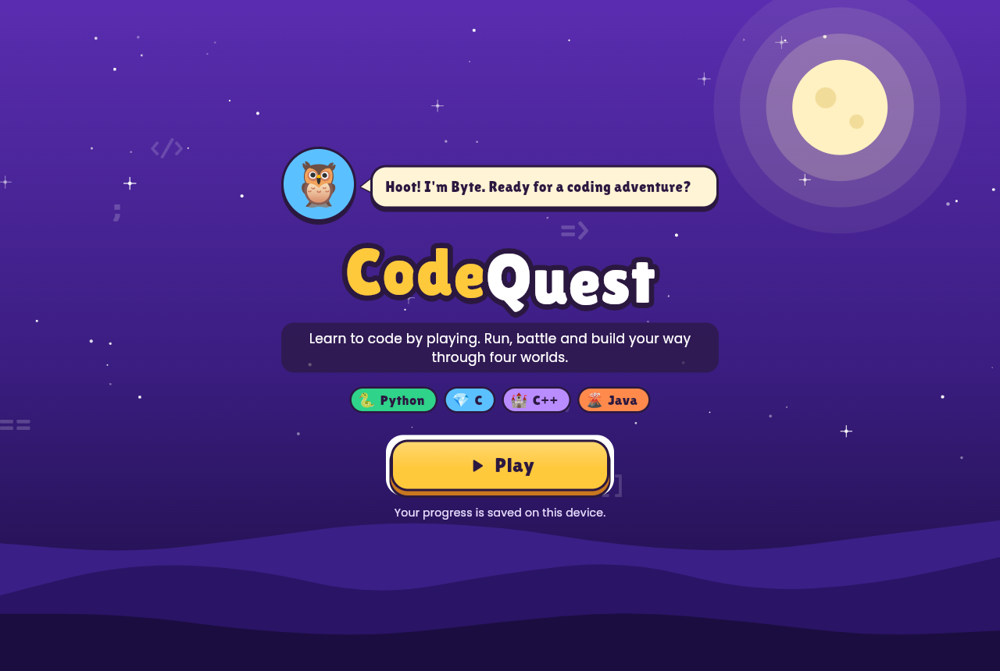 |  |  |
| **Lesson with Byte** | **World Builder: say the password** | **The gate opens** |
|  | 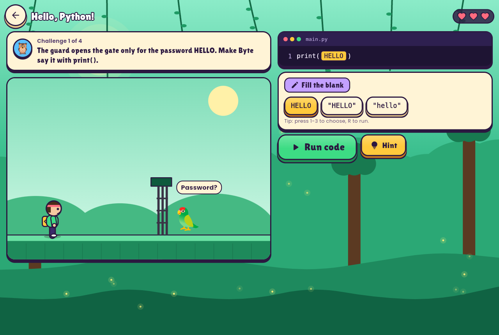 | 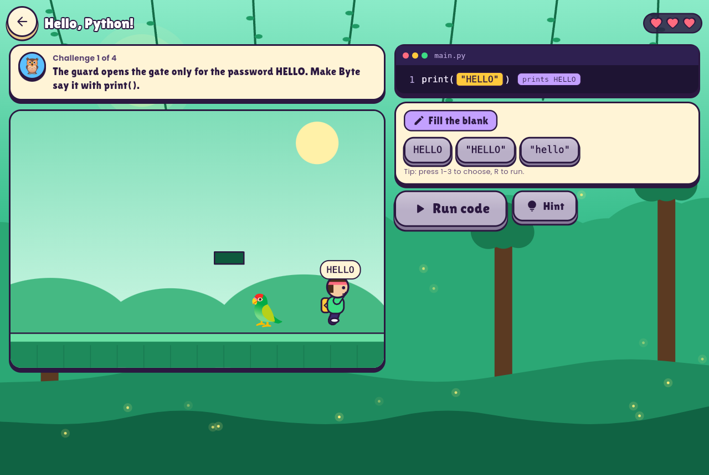 |
| **A variable sets the jump** | **Bug! One block short - Byte falls in** | **Bug fixed: a perfect bridge** |
| 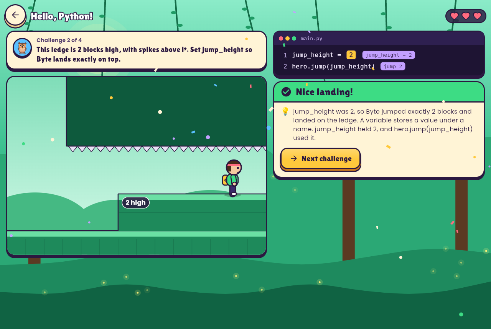 | 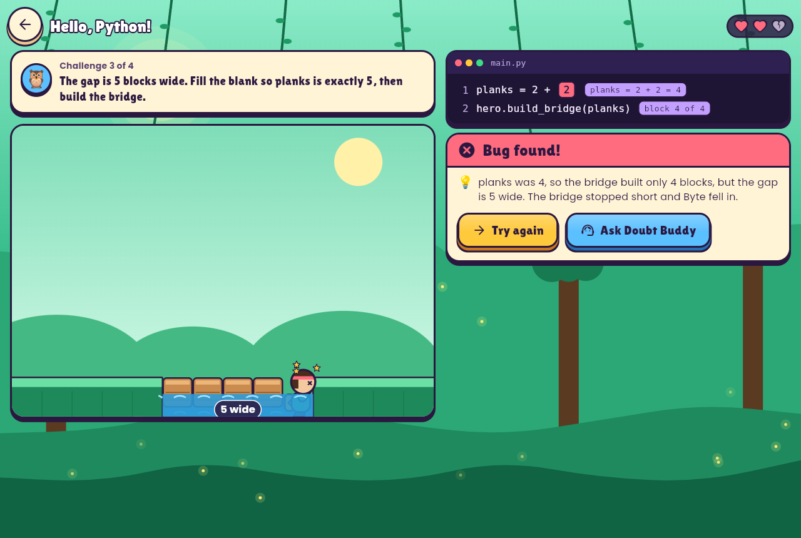 | 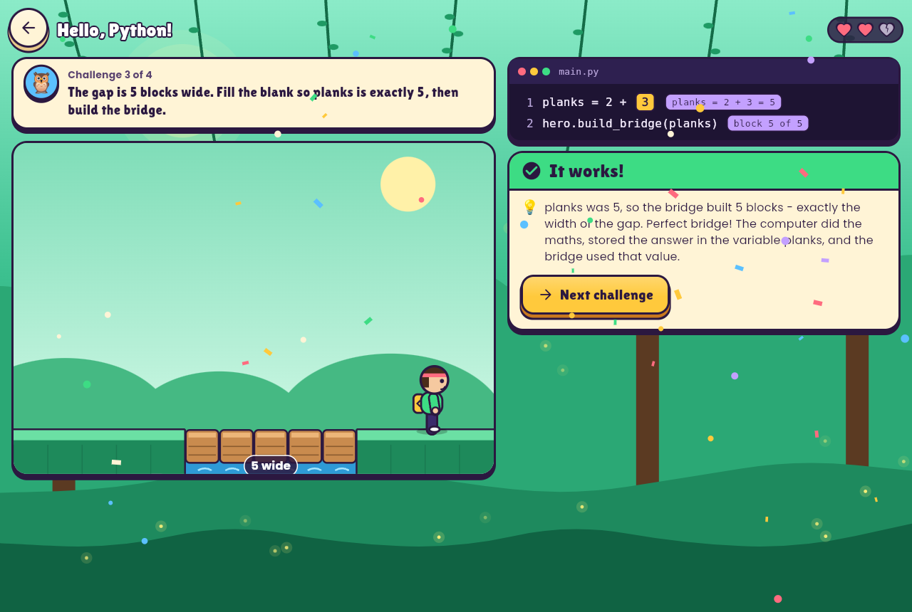 |
| **Level clear** | **Bug Battle** | **Code bolt attack** |
|  |  | 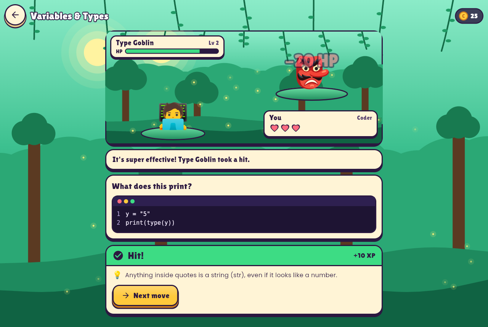 |
| **Learning from a miss** | **Block Builder** | **Run code: console output** |
| 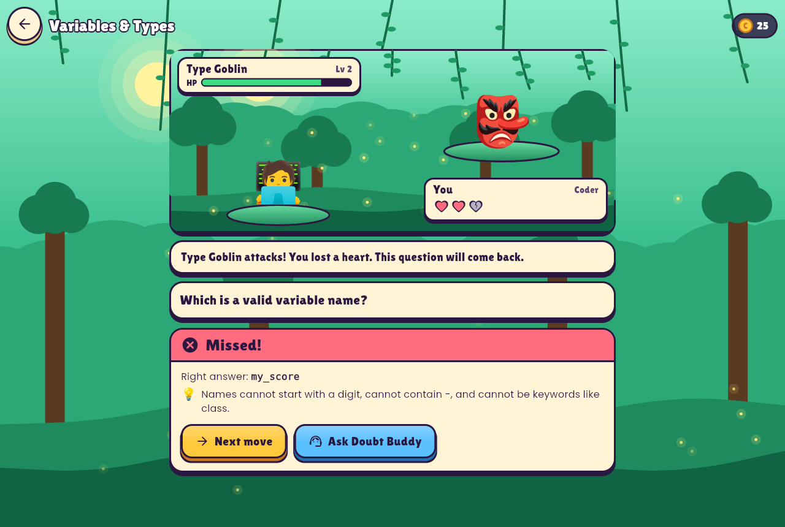 | 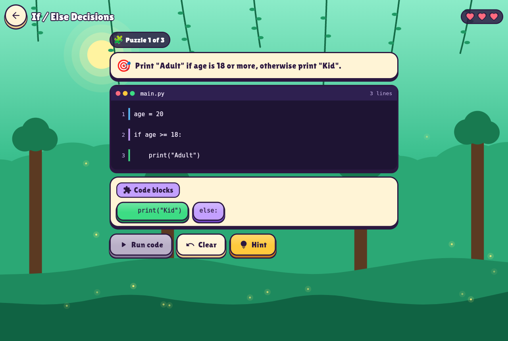 | 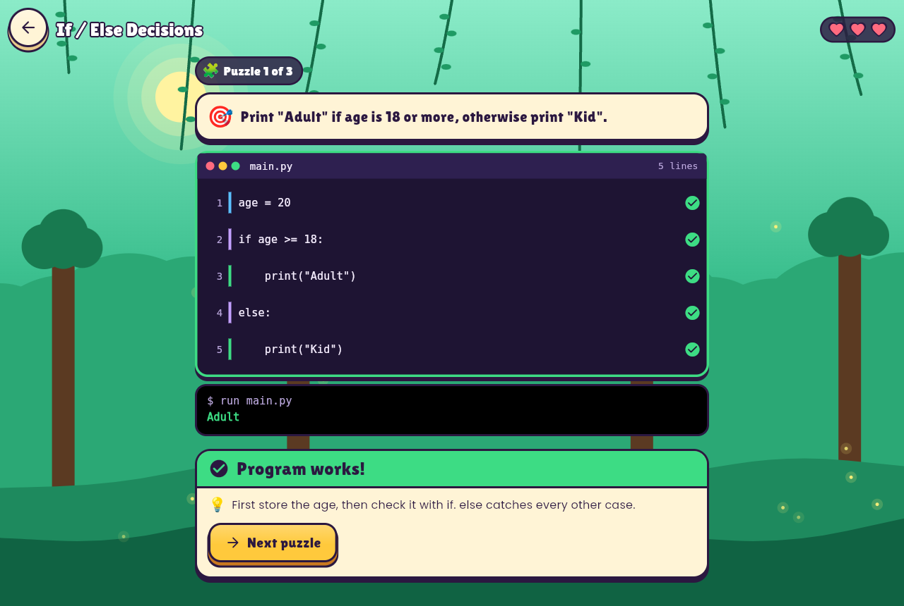 |
| **Trophy room** | **Doubt Buddy** | **High-contrast mode** |
| 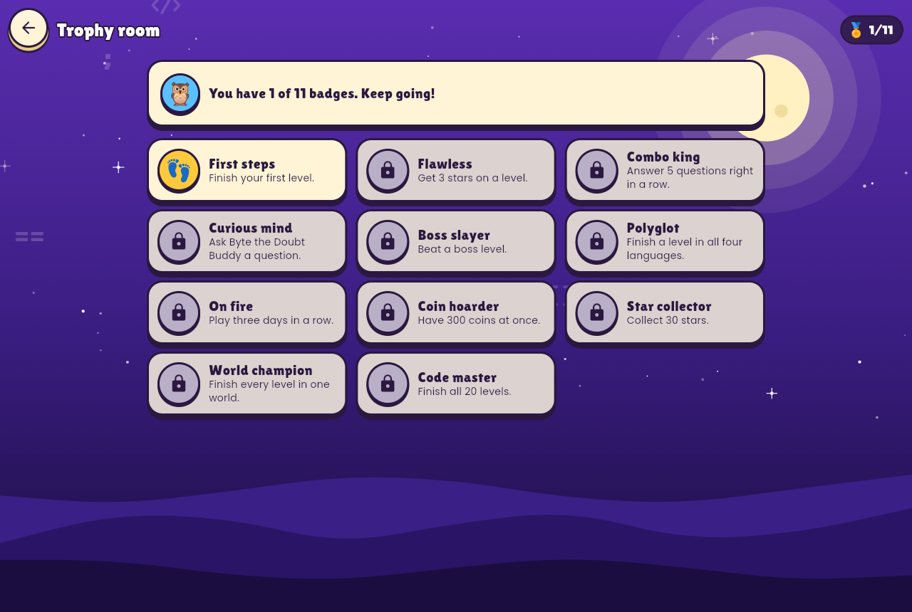 | 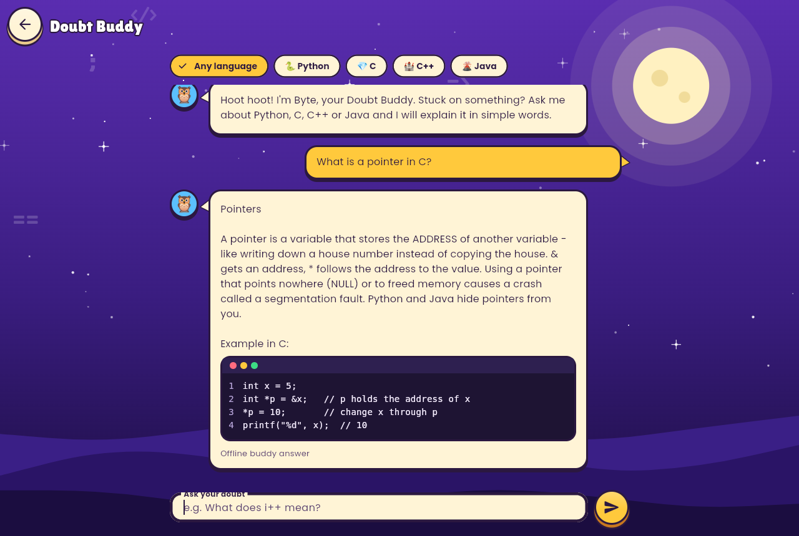 | 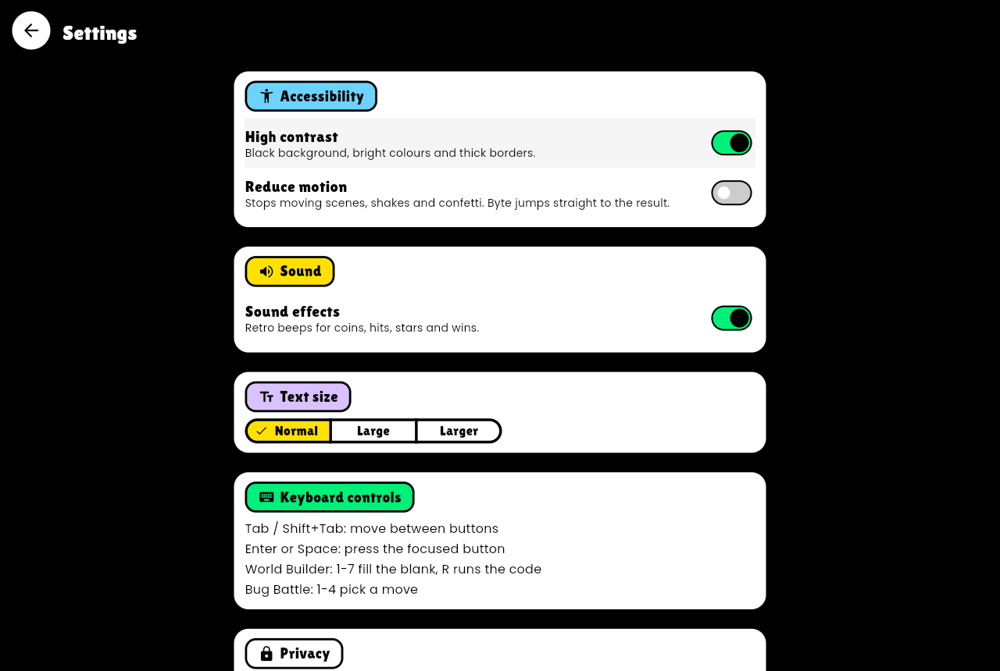 |
| **Mobile: title** | **Mobile: home** | **Mobile: map** |
| 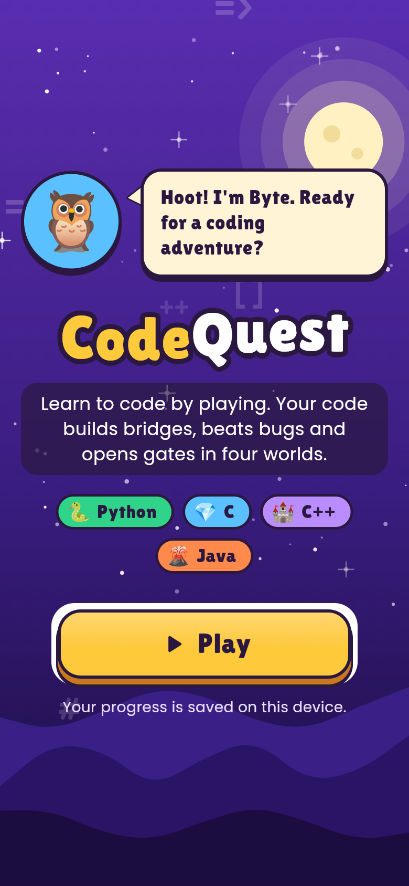 | 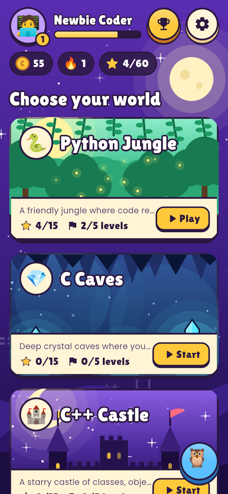 | 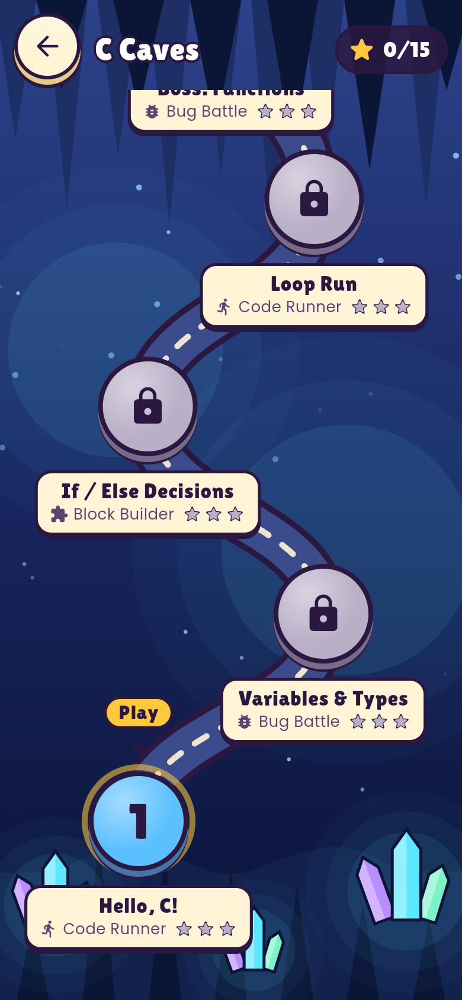 |
| **Mobile: World Builder** | | |
| 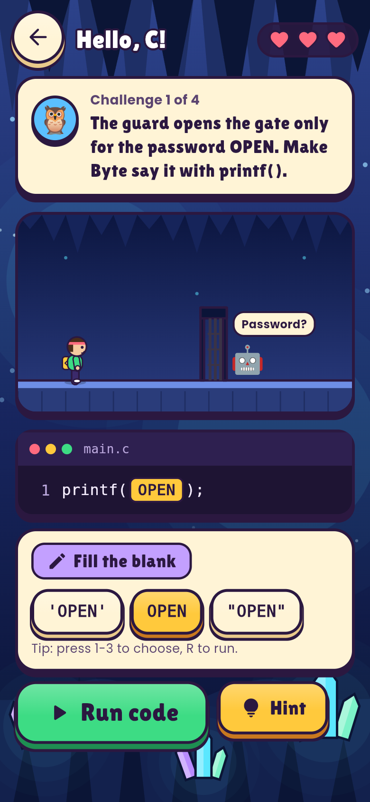 | | |

Screenshots and the demo video are made automatically by [a GitHub Action](.github/workflows/screenshots.yml) that plays the real game in headless Chrome ([tool/screenshots/capture.mjs](tool/screenshots/capture.mjs)).

---

## ✅ Judging criteria — what we did

### 🔐 Security
- **No secrets in the app.** The AI key lives only in Vercel environment variables and is used by the server function [`api/ask.js`](api/ask.js). The browser never sees it.
- **Strict input validation** on the server ([`api/_lib/tutor.js`](api/_lib/tutor.js)): JSON-only, 4 KB body limit, allow-listed fields, length limits, control characters stripped, language must be one of 4 values.
- **Abuse protection:** per-client rate limiting (10 questions/minute), same-origin check, 15 s upstream timeout, `Cache-Control: no-store`.
- **Prompt-injection hardening:** student text is sent as *data*, separate from the tutor rules, with a short output limit and Gemini safety settings.
- **Privacy:** no accounts, no personal data, questions are not logged or stored; progress stays on the device.
- **Security headers** on every response ([`vercel.json`](vercel.json)): strict **Content-Security-Policy** (no inline scripts, no third-party scripts), HSTS, `X-Frame-Options: DENY`, `nosniff`, Referrer-Policy, Permissions-Policy, COOP/CORP.
- **No third-party CDNs:** the Flutter engine (CanvasKit) and fonts are self-hosted (`--no-web-resources-cdn`, bundled fonts), so the CSP can stay strict.
- **Untrusted local data is validated:** saved progress is parsed defensively — corrupted or tampered values are clamped or ignored (tested).
- **Small supply chain:** only 3 runtime packages (`http`, `shared_preferences`, `web` — all from the Dart/Flutter teams); the API has **zero** npm dependencies; Dependabot watches updates; the Flutter SDK version is pinned for builds.
- Code answers are **never executed** — the game only shows code, so there is no code-execution risk.

See [SECURITY.md](SECURITY.md).

### ♿ Accessibility
- **Screen readers:** every button, blank, move and block has a clear label, and the World Builder stage is described in words ("Byte stands before a gap 5 blocks wide. The code has built 4 blocks."); hearts, health and stars are read out ("2 of 3 hearts left"); feedback is announced with live regions. On the web, accessibility is switched on at start-up so screen readers work immediately.
- **Full keyboard play:** Tab/Enter everywhere; World Builder: number keys pick the value for the blank, R runs the code; Battle: 1–4 to attack.
- **No timing pressure:** World Builder has no timer at all — think, run, fix, run again (WCAG 2.2.1).
- **Reduce motion** setting (and respects the device setting): stops the animated scenes, shakes and confetti; in World Builder, Byte goes straight to the result.
- **High-contrast mode** and **bigger text** (3 sizes, on top of the device text size).
- Colour is never the only signal — right/wrong always also shows ✓/✗ icons and text.
- Large touch targets (≥ 48 px), WCAG AA text contrast — **checked automatically** by tests on every screen in both normal and high-contrast themes.

### 🧪 Testing
- **Flutter tests** (`flutter test`):
  - [`curriculum_test.dart`](test/curriculum_test.dart) — every level/question/puzzle is well-formed (unique ids, valid answers, no duplicate options…)
  - [`builder_test.dart`](test/builder_test.dart) — World Builder: every challenge has exactly one right answer and starts on a wrong one, real syntax per language, loop/off-by-one/while/running-total simulation, strings and quotes, hearts and retries, Byte's animation path for every outcome
  - [`game_logic_test.dart`](test/game_logic_test.dart) — battle rules, combos, 50/50 power-up, puzzle rules, hints, stars, XP
  - [`progress_test.dart`](test/progress_test.dart) — unlocking, streaks, badges, coin spending, saving/loading, tampered-data handling
  - [`sound_test.dart`](test/sound_test.dart) — every sound effect is short and quiet, and playing sounds is safe on every platform
  - [`doubt_service_test.dart`](test/doubt_service_test.dart) — input sanitising, topic matching, AI → offline fallback with a mock server
  - [`widget_test.dart`](test/widget_test.dart) — title screen → hub, plays full levels: World Builder (perfect run, a bug that costs a heart, running out of hearts, keyboard), battle (incl. 50/50), puzzle (incl. console output and wrong order), trophy room, Doubt Buddy, settings
  - [`accessibility_test.dart`](test/accessibility_test.dart) — Flutter accessibility guidelines (tap targets, labels, contrast) on all 12 screens, in normal and high-contrast mode
- **API tests** (`npm test`) — validation, rate limiting, origin check, handler status codes.
- **End-to-end:** the screenshot workflow plays the real web build in Chrome and fails on errors or CSP violations.
- **CI** ([`.github/workflows/ci.yml`](.github/workflows/ci.yml)) runs analyze + tests + web build + Android APK build on every push.

### 🧹 Code quality
- Clear structure: `models/` (data types), `data/` (all lessons as plain data), `logic/` (pure, UI-free game rules and badges), `services/` (doubt solver, sound effects), `screens/`, `widgets/` (game UI kit, painted scenes, effects), `theme/` (design tokens).
- A small, consistent game UI kit ([`lib/widgets/game_ui.dart`](lib/widgets/game_ui.dart)): 3D `GameButton`, `ParchmentPanel`, `OutlinedText`, HUD pills. Every screen uses the same pieces, so the look stays consistent and accessible.
- All scenery is drawn in code with `CustomPainter` ([`lib/widgets/scenes.dart`](lib/widgets/scenes.dart)), so there are no image downloads.
- Game rules are pure Dart classes, so they are easy to test and reuse.
- Strict analyzer settings (`strict-casts`, `strict-inference`, `strict-raw-types`) + extra lints; `flutter analyze` reports **no issues**.
- No extra state-management package — a small `InheritedNotifier` keeps things simple.

---

## Run it yourself

```bash
flutter pub get
flutter run -d chrome          # web
flutter test                   # all Flutter tests
npm test                       # API tests (Node 20+)
```

**Mobile (Android / iOS):** native folders are generated, not committed:

```bash
flutter create --platforms=android,ios --org io.github.omshiva24 --project-name codequest .
flutter run --dart-define=TUTOR_API_BASE=https://codequest-game-amber.vercel.app
```
CI also builds a ready-to-install **Android APK** (download it from the latest *CI* run → Artifacts).

### Deploy on Vercel
The repo is ready for Vercel: [`vercel.json`](vercel.json) installs a pinned Flutter SDK, builds the web app and adds the security headers.
To enable the AI tutor, add an environment variable in Vercel → Project → Settings → Environment Variables:

| Name | Value |
|---|---|
| `GEMINI_API_KEY` | your Google AI Studio key (keep it secret) |
| `GEMINI_MODEL` *(optional)* | defaults to `gemini-2.5-flash` |

## Project structure

```
lib/
  data/          curriculum.dart (lessons & questions), builder_levels.dart (World Builder challenges), doubt_kb.dart (offline tutor), fun_facts.dart
  logic/         builder.dart (World Builder engine: code in 4 syntaxes + step-by-step simulation), quiz_session.dart, puzzle_session.dart, scoring.dart, progress.dart, achievements.dart
  models/        models.dart
  screens/       title, home hub, world map, lesson, world builder, battle, puzzle, results, trophy room, doubt buddy, settings, about (creator)
  services/      doubt_service.dart (offline tutor + secure AI client)
  theme/         app_theme.dart (normal + high contrast)
  widgets/       game_ui.dart (buttons, panels, HUD), scenes.dart (painted worlds), builder_stage.dart (side-scrolling stage + Byte), effects.dart (confetti, shake...)
api/             ask.js (serverless AI endpoint), _lib/tutor.js (validation, rate limit)
api-tests/       Node tests for the API
test/            Flutter unit, widget and accessibility tests
tool/screenshots capture.mjs (plays the game, takes screenshots + video frames)
```

## Creator and copyright

CodeQuest — its idea, game design, code, levels, characters and text — was created by **P Om Shiva**, M.Tech CSE (2nd year), Pondicherry University ([@omshiva24](https://github.com/omshiva24)).

**© 2026 P Om Shiva. All rights reserved.** No licence is granted to copy, modify, publish, re-upload or present this work (or any part of it) as your own. Reviewing it for evaluation (for example by judges and faculty) and playing the published game are fine. For anything else, ask P Om Shiva for written permission. Full terms: [LICENSE](LICENSE).

The creator's name is shown inside the game too: on the title screen, the home screen, Settings and the **About CodeQuest** screen ("Why I made this").

Third-party parts keep their own licences: Flutter and Dart packages (BSD-3-Clause); fonts Lilita One and Poppins (SIL OFL 1.1) and DejaVu Sans Mono (Bitstream Vera licence) — see `assets/fonts/`.
