# 🦉 CodeQuest — Learn to Code by Playing

**CodeQuest** is a game that teaches **Python, C, C++ and Java** the way Mario, Temple Run and Pokémon keep you hooked: worlds to unlock, runs to survive, monsters to beat — and a friendly **Doubt Buddy** that answers your questions in simple words.

Built with **Flutter** (one codebase for web + Android/iOS), deployed on **Vercel**.

**▶ Play now: https://codequest-game-amber.vercel.app**

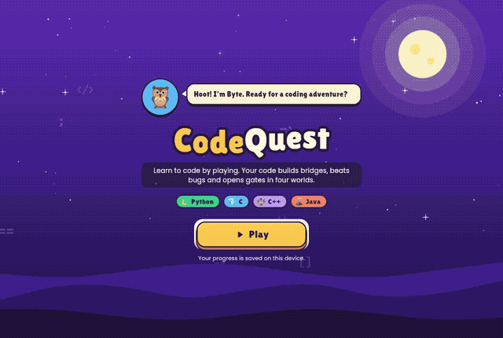

> Full-quality demo video: [docs/demo.mp4](docs/demo.mp4)

---

## How it plays

| | Mini-game | Inspired by | What you do |
|---|---|---|---|
| 🏃 | **Code Runner** | Temple Run | The answers are gates on a 3-lane track. Switch lanes and run through the right one before the gates reach you. |
| 👾 | **Bug Battle** | Pokémon | A bug monster attacks. Pick the right "move" (answer) to hit it. Missed questions come back so you can learn and still win. |
| 🧱 | **Block Builder** | Mario blocks | Tap shuffled code blocks in the right order to build a working program, then press Check. |

Each language is a **world** on a Mario-style map with 5 levels — the 5th is a **boss**:

| World | Levels |
|---|---|
| 🐍 Python Jungle | Hello Python → Variables & Types → If/Else → Loops → **Boss: Functions** (Bug King) |
| ⛏️ C Caves | Hello C → Variables & Types → If/Else → Loops → **Boss: Functions** (Segfault Dragon) |
| 🏰 C++ Castle | Hello C++ → Variables & Types → If/Else → Loops & vectors → **Boss: Classes** (Null Pointer Ghost) |
| 🌋 Java Volcano | Hello Java → Variables & Types → If/Else → Loops & arrays → **Boss: Methods & Objects** (Exception Hydra) |

Every level starts with a short **lesson scroll** (simple words + example code + key points). After every answer you get an **explanation**, and the results screen has a **"Learn from your mistakes"** review. You earn **XP, coins, stars and a daily streak**, and finishing a level unlocks the next.

### 🦉 Doubt Buddy (doubt solver)
Stuck? Ask Byte the owl anything — "What is a pointer in C?", "for vs while?", "Why do I need a semicolon?".
- **Works offline** with a built-in knowledge base of 30+ beginner topics, with examples in the language you pick.
- **Optional AI tutor**: if a `GEMINI_API_KEY` is set on Vercel, questions go to a secure server function (`/api/ask`) for richer answers. If the AI is unavailable, the offline buddy answers automatically — the player is never left without help.
- Every wrong answer has an **"Ask Doubt Buddy"** button that sends the question and its context.

## Screenshots

| Home | World map | Lesson |
|---|---|---|
| 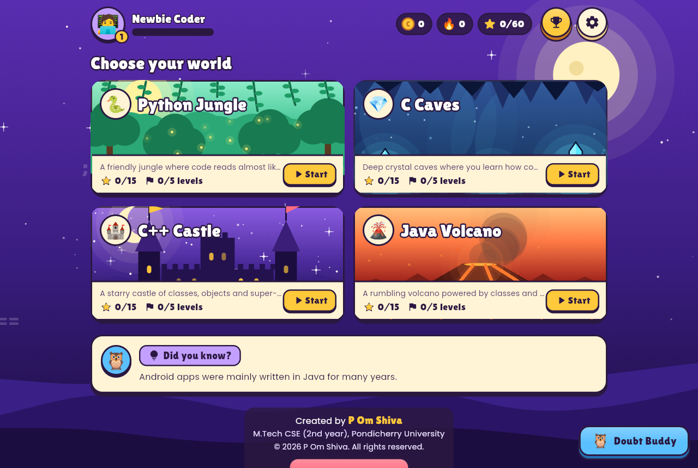 | 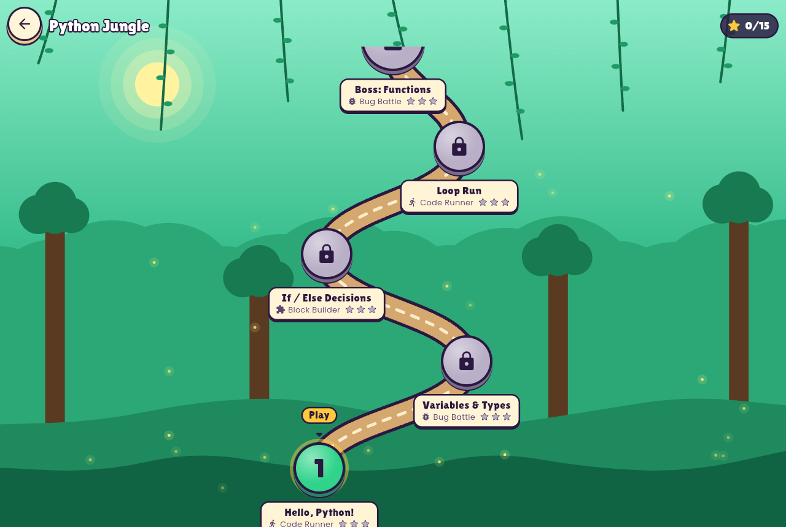 | 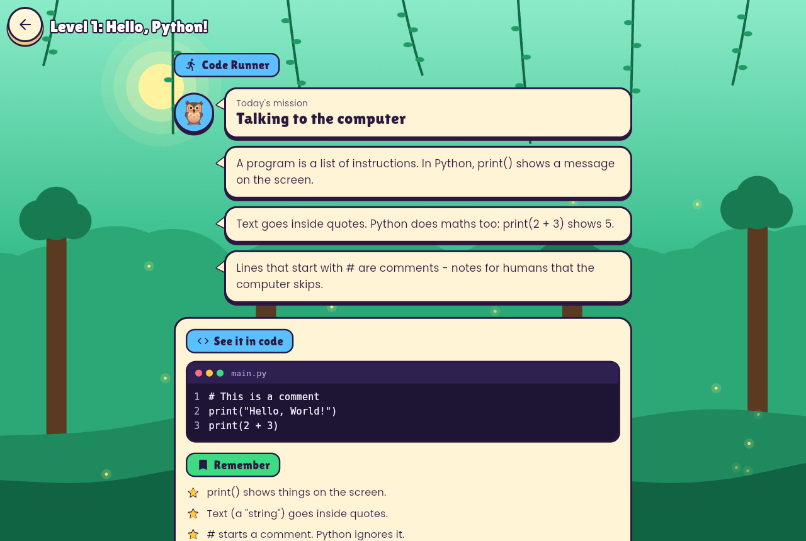 |
| **Code Runner** | **Right answer!** | **Results** |
| 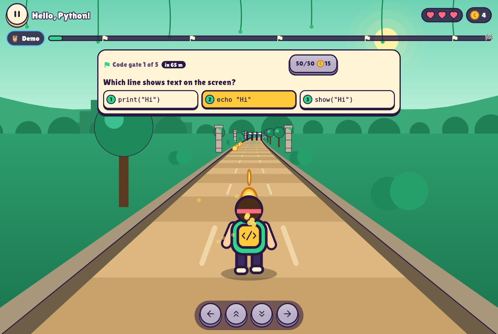 | 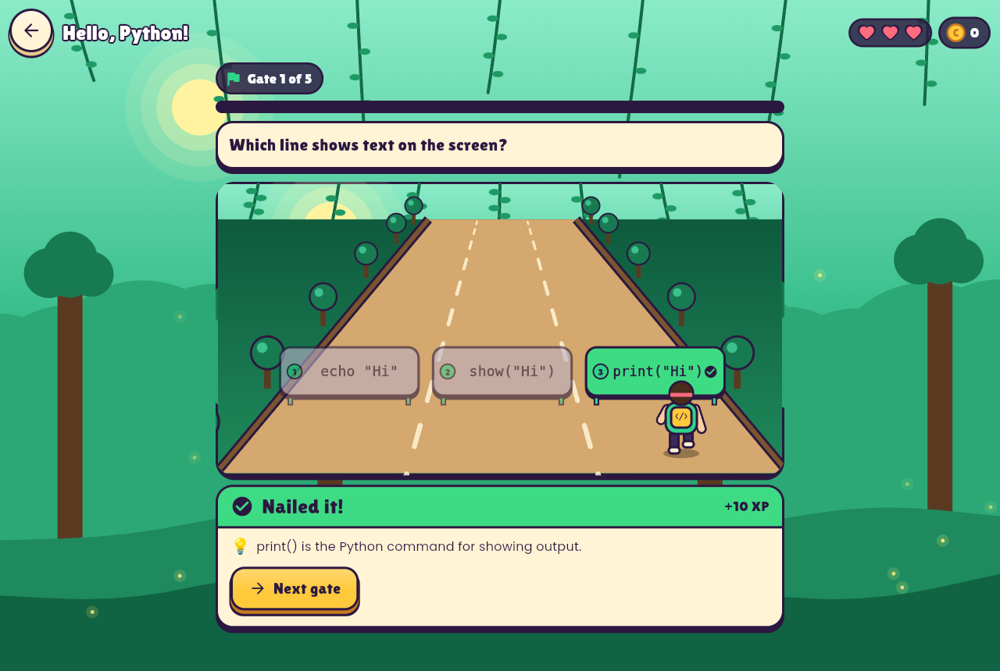 | 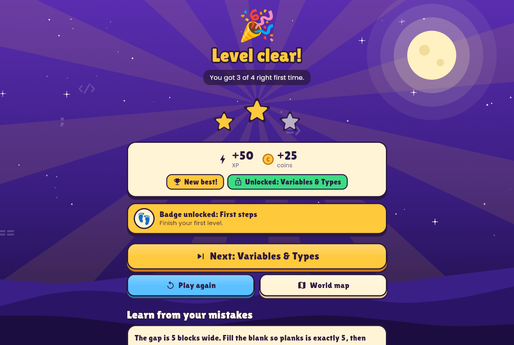 |
| **Bug Battle** | **Learning from a mistake** | **Block Builder** |
| 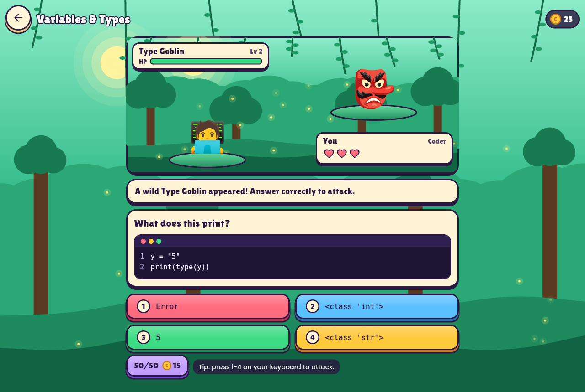 | 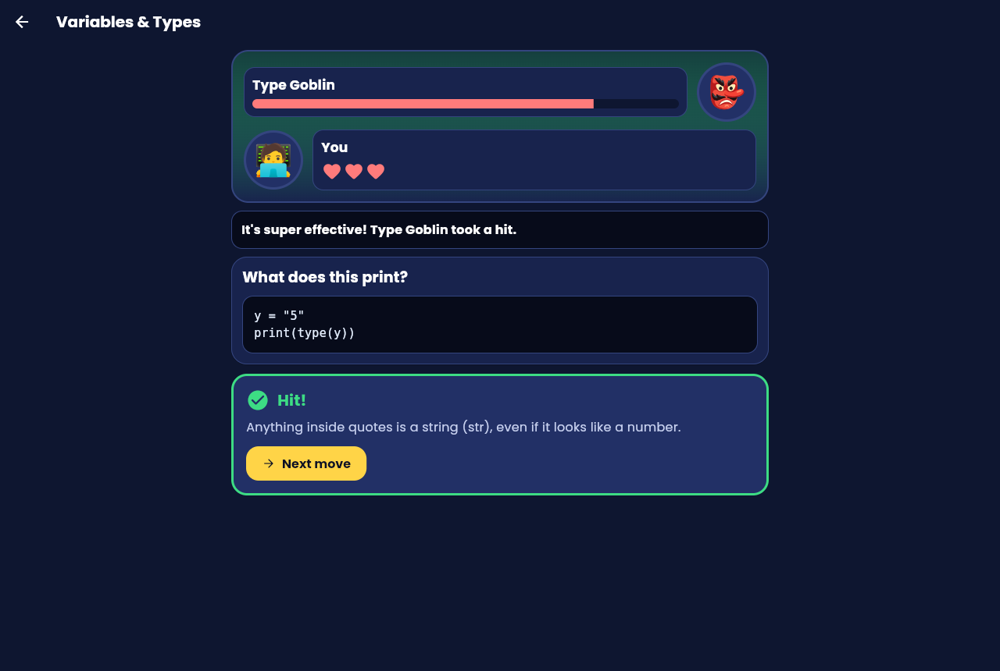 | 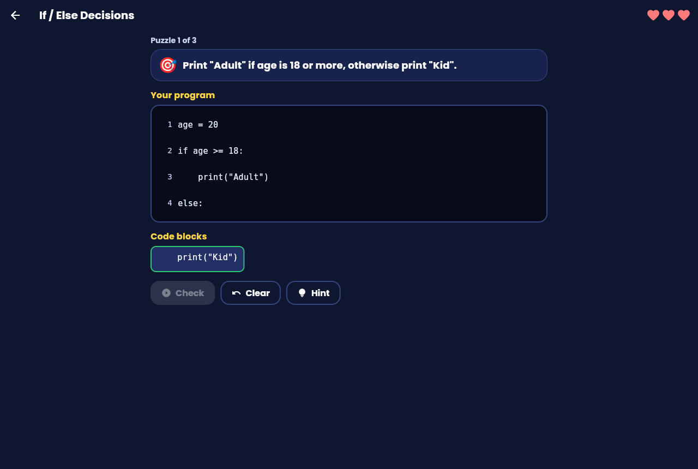 |
| **Doubt Buddy** | **High-contrast mode** | **Mobile** |
| 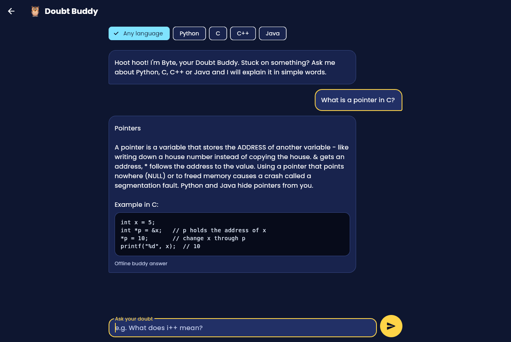 | 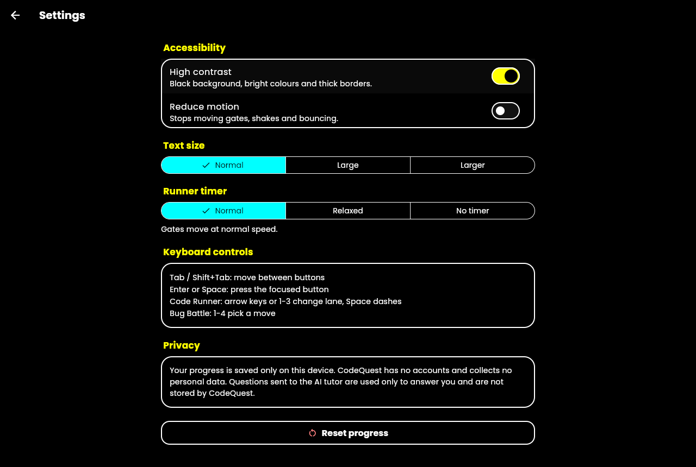 | 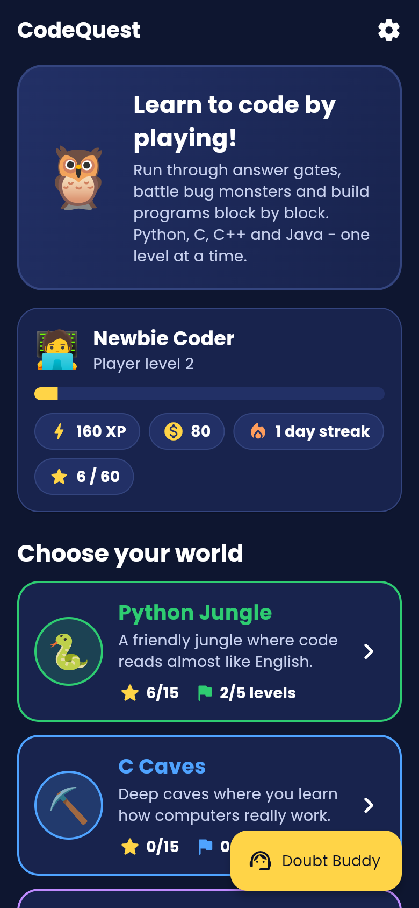 |

Screenshots and the demo video are produced automatically by [a GitHub Action](.github/workflows/screenshots.yml) that plays the real game in headless Chrome ([tool/screenshots/capture.mjs](tool/screenshots/capture.mjs)).

---

## ✅ Judging criteria — what we did

### 🔐 Security
- **No secrets in the app.** The AI key lives only in Vercel environment variables and is used by the server function [`api/ask.js`](api/ask.js). The browser never sees it.
- **Strict input validation** on the server ([`api/_lib/tutor.js`](api/_lib/tutor.js)): JSON-only, 4 KB body limit, allow-listed fields, length limits, control characters stripped, language must be one of 4 values.
- **Abuse protection:** per-client rate limiting (10 questions/minute), same-origin check, 15 s upstream timeout, `Cache-Control: no-store`.
- **Prompt-injection hardening:** student text is sent as *data*, separate from the tutor rules, with a short output limit and Gemini safety settings.
- **Privacy:** no accounts, no personal data, questions are not logged or stored; progress stays on the device.
- **Security headers** on every response ([`vercel.json`](vercel.json)): strict **Content-Security-Policy** (no inline scripts, no third-party scripts), HSTS, `X-Frame-Options: DENY`, `nosniff`, Referrer-Policy, Permissions-Policy, COOP/CORP.
- **No third-party CDNs:** the Flutter engine (CanvasKit) and fonts are self-hosted (`--no-web-resources-cdn`, bundled fonts), so the CSP can stay strict.
- **Untrusted local data is validated:** saved progress is parsed defensively — corrupted or tampered values are clamped or ignored (tested).
- **Small supply chain:** only 2 runtime packages (`http`, `shared_preferences`, both from the Dart/Flutter teams); the API has **zero** npm dependencies; Dependabot watches updates; the Flutter SDK version is pinned for builds.
- Code answers are **never executed** — the game only shows code, so there is no code-execution risk.

See [SECURITY.md](SECURITY.md).

### ♿ Accessibility
- **Screen readers:** every button, gate, move and block has a clear label; hearts, health and stars are read out ("2 of 3 hearts left"); feedback is announced with live regions. On the web, accessibility is switched on at start-up so screen readers work immediately.
- **Full keyboard play:** Tab/Enter everywhere; Runner: ←/→ or 1–3 to change lane, Space to dash; Battle: 1–4 to attack.
- **No timing pressure if you need it:** Runner timer can be Normal, Relaxed (2×) or Off (WCAG 2.2.1).
- **Reduce motion** setting (and respects the device setting): stops moving gates, shakes and bouncing.
- **High-contrast mode** and **bigger text** (3 sizes, on top of the device text size).
- Colour is never the only signal — right/wrong always also shows ✓/✗ icons and text.
- Large touch targets (≥ 48 px), WCAG AA text contrast — **checked automatically** by tests on every screen in both normal and high-contrast themes.

### 🧪 Testing
- **Flutter tests** (`flutter test`):
  - [`curriculum_test.dart`](test/curriculum_test.dart) — every level/question/puzzle is well-formed (unique ids, valid answers, no duplicate options…)
  - [`game_logic_test.dart`](test/game_logic_test.dart) — runner/battle rules, puzzle rules, hints, stars, XP
  - [`progress_test.dart`](test/progress_test.dart) — unlocking, streaks, saving/loading, tampered-data handling
  - [`doubt_service_test.dart`](test/doubt_service_test.dart) — input sanitising, topic matching, AI → offline fallback with a mock server
  - [`widget_test.dart`](test/widget_test.dart) — plays full levels: runner (incl. keyboard + timer), battle, puzzle, Doubt Buddy, settings
  - [`accessibility_test.dart`](test/accessibility_test.dart) — Flutter accessibility guidelines (tap targets, labels, contrast) on every screen
- **API tests** (`npm test`) — validation, rate limiting, origin check, handler status codes.
- **End-to-end:** the screenshot workflow plays the real web build in Chrome and fails on errors or CSP violations.
- **CI** ([`.github/workflows/ci.yml`](.github/workflows/ci.yml)) runs analyze + tests + web build + Android APK build on every push.

### 🧹 Code quality
- Clear structure: `models/` (data types), `data/` (all lessons as plain data), `logic/` (pure, UI-free game rules), `services/` (doubt solver), `screens/`, `widgets/`, `theme/`.
- Game rules are pure Dart classes, so they are easy to test and reuse.
- Strict analyzer settings (`strict-casts`, `strict-inference`, `strict-raw-types`) + extra lints; `flutter analyze` reports **no issues**.
- No extra state-management package — a small `InheritedNotifier` keeps things simple.

---

## Run it yourself

```bash
flutter pub get
flutter run -d chrome          # web
flutter test                   # all Flutter tests
npm test                       # API tests (Node 20+)
```

**Mobile (Android / iOS):** native folders are generated, not committed:

```bash
flutter create --platforms=android,ios --org io.github.omshiva24 --project-name codequest .
flutter run --dart-define=TUTOR_API_BASE=https://codequest-game-amber.vercel.app
```
CI also builds a ready-to-install **Android APK** (download it from the latest *CI* run → Artifacts).

### Deploy on Vercel
The repo is ready for Vercel: [`vercel.json`](vercel.json) installs a pinned Flutter SDK, builds the web app and adds the security headers.
To enable the AI tutor, add an environment variable in Vercel → Project → Settings → Environment Variables:

| Name | Value |
|---|---|
| `GEMINI_API_KEY` | your Google AI Studio key (keep it secret) |
| `GEMINI_MODEL` *(optional)* | defaults to `gemini-2.5-flash` |

## Project structure

```
lib/
  data/          curriculum.dart (lessons & questions), doubt_kb.dart (offline tutor)
  logic/         quiz_session.dart, puzzle_session.dart, scoring.dart, progress.dart
  models/        models.dart
  screens/       home, world map, lesson, runner, battle, puzzle, results, doubt buddy, settings
  services/      doubt_service.dart (offline tutor + secure AI client)
  theme/         app_theme.dart (normal + high contrast)
  widgets/       shared UI pieces
api/             ask.js (serverless AI endpoint), _lib/tutor.js (validation, rate limit)
api-tests/       Node tests for the API
test/            Flutter unit, widget and accessibility tests
tool/screenshots capture.mjs (plays the game, takes screenshots + video frames)
```

## Credits
Made by **P Om Shiva** (M.Tech CSE, Pondicherry University).
Fonts: Poppins (SIL OFL 1.1), DejaVu Sans Mono (Bitstream Vera license) — see `assets/fonts/`.
Code licensed under the [MIT License](LICENSE).
